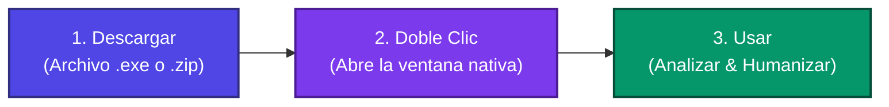

# HumanTextSuite 🧠✨
### Detector de Texto Generado por IA, Corrección de Estilo y Motor de Humanización de Contenido


---

## 🌟 Acceso Rápido para Todos (Cero Fricción, Sin Comandos)

**HumanTextSuite** está diseñada para que cualquier persona pueda usarla de inmediato, sin necesidad de saber programación, sin abrir terminales y sin tener Node.js instalado:

| 🌐 Opción 1: Usar Online (Inmediato) | 💻 Opción 2: Descargar para Windows (.exe) |
|:---:|:---:|
| **Usa la aplicación directamente en tu navegador sin instalar nada.** | **Descarga el instalador o ejecutable portable autosuficiente.** |
| [-success?style=for-the-badge&logo=googlechrome&logoColor=white)](https://sraxelito.github.io/human-text-suite/) | [-informational?style=for-the-badge&logo=windows&logoColor=white)](https://github.com/SrAxelito/human-text-suite/releases/latest) |
| 👉 **[Abrir en el Navegador](https://sraxelito.github.io/human-text-suite/)** | 👉 **[Descargar última versión (.exe)](https://github.com/SrAxelito/human-text-suite/releases/latest)** |

---

### 🚀 Guía en 3 Pasos (Para Usuarios de Windows)



1. **Paso 1: Descargar:** Ve a [GitHub Releases](https://github.com/SrAxelito/human-text-suite/releases/latest) y descarga `HumanTextSuite-Setup.exe` (instalador tradicional) o `HumanTextSuite-Portable.zip` (portable sin instalación).
2. **Paso 2: Abrir:** Haz doble clic sobre el archivo descargado. La aplicación abrirá directamente su ventana de escritorio nativa con diseño premium. No necesitas tener Node.js, Git ni Python instalados.
3. **Paso 3: Usar:** Pega tu texto o arrastra un documento de Word (`.docx`), visualiza el análisis estadístico frase a frase y humaniza el contenido con un solo clic.

---

## 📋 1. Visión General del Proyecto

**HumanTextSuite** es una solución modular de ingeniería de software diseñada para la detección estadística y probabilística de texto sintético generado por Modelos de Lenguaje Grande (LLMs como ChatGPT, Claude, Gemini, etc.), combinada con temas visuales claro/oscuro inspirados en el diseño Primer de GitHub, scrollbar estilizado, navegación exclusiva por clic, segmentación inteligente para documentos extensos, importación de documentos Word (.docx), un motor desacoplado de reescritura, humanización de contenido y reanálisis comparativo cuantitativo (*Diff View*).

### Novedades en v1.6.1:
- **Rediseño Completo al Estilo GitHub (Modo Claro y Oscuro):** Adopción estricta de la identidad visual de GitHub (Primer) con bordes finos de 1px (`#d0d7de` en claro, `#30363d` en oscuro) y radio uniforme de 6px (`border-radius: 6px`).
- **Eliminación de Grises Incoherentes y Franjas Oscuras en Modo Claro:** Corrección del fondo del editor de texto y barra de conteo de palabras, unificándolos de manera limpia en `#ffffff` y `#f6f8fa` con texto `#57606a`.
- **Panel de Métricas & Diagnóstico Estilizado:** Eliminación del bloque gris oscuro del héroe del gauge, incorporando un anillo sutil de progreso y tarjeta de instrucciones como alerta nativa de GitHub (`#ddf4ff` / `#54aeff`).
- **Segmented Controls Nativos de GitHub:** Pestañas superiores (`Editor`, `Visor con Margen`, `Visor Diff`) adaptadas fielmente al patrón de controles segmentados interactivos de GitHub.

### Novedades en v1.6.0:
- **Ejecutables de Escritorio Nativos para Windows:** Distribución standalone y portable autosuficiente (`.exe` y `.zip`) sin ventanas de terminal ni necesidad de instalar Node.js o Git.
- **Despliegue Continuo Web Automático:** Integración con GitHub Pages (`.github/workflows/deploy.yml`), Vercel (`vercel.json`) y Netlify (`netlify.toml`) para acceso online inmediato desde cualquier dispositivo.
- **Flujo de Automatización CI/CD (`.github/workflows/release.yml`):** Compilación automática y adjunción de instaladores y binarios en los Releases de GitHub en cada nueva versión.
- **Rediseño Centrado en el Usuario Final:** Acceso prioritario sin terminales en la documentación con botones directos y guía visual en 3 pasos.

### Novedades en v1.5.1:
- **Corrección de Arranque Persistente en Windows (`iniciar.bat`):** Diagnóstico y solución definitiva para el falso positivo en la detección de dependencias y cierre del script.
- **Detección Resiliente de Entorno Node.js y npm:** Inclusión automática en PATH de directorios estándar de Windows (`Program Files`, `AppData\Local\Programs`) y eliminación de fallos de parsing por paréntesis en scripts Batch.
- **Arranque en Ventana Dedicada con Logs Activos:** Lanzamiento del servidor Vite mediante `start "HumanTextSuite - Servidor" cmd /k "npm run dev"` para mantener la consola abierta con los logs en tiempo real.
- **Temporizador de Enlace y Puerto Estricto:** Pausa controlada de 3 segundos antes de abrir el navegador y configuración de `--port 5173 --strictPort` para garantizar que la conexión nunca sea rechazada.

### Novedades en v1.5.0:
- **Arranque e Instalación Automática en Un Solo Clic (`iniciar.bat` / `iniciar.sh`):** Scripts multiplataforma con verificación de dependencias y apertura automática de navegador.
- **Herramientas de Reseteo y Mantenimiento (`limpiar.bat` / `limpiar.sh`):** Scripts para purgar caché y reinstalar dependencias limpias.

---

## ⚡ 2. Ejecución Local con Scripts de Un Solo Clic

Si has clonado el repositorio y deseas ejecutarlo localmente desde el código fuente sin escribir comandos en la terminal:

- **En Windows:** Haz doble clic en **`iniciar.bat`**.
- **En macOS / Linux:** Ejecuta **`./iniciar.sh`** en la terminal.

El script comprobará Node.js, instalará dependencias en la primera ejecución, levantará el servidor en el puerto 5173 y abrirá la aplicación en tu navegador de forma automática.

> [!TIP]
> **Limpieza rápida:** Usa **`limpiar.bat`** (Windows) o **`./limpiar.sh`** (Mac/Linux) para borrar `node_modules`, dist y caché de compilación en caso de requerir un reseteo limpio.

---

<details>
<summary><strong>🔬 3. Fundamentos Algorítmicos y Matemáticos</strong> (Haz clic para desplegar)</summary>

### 3.1. Perplejidad ($PPL$) y Entropía Cruzada
La perplejidad cuantifica qué tan "sorprendido" se encuentra un modelo probabilístico ante una secuencia de texto:

$$PPL(W) = \exp\left( - \frac{1}{N} \sum_{i=1}^N \ln P(w_i \mid w_{i-1}, \dots) \right)$$

- **Textos de LLMs:** Al generar texto seleccionando tokens con alta probabilidad condicional (baja entropía), exhiben una perplejidad baja y predecible.
- **Textos Humanos:** Incorporan giros coloquiales, léxico variado y transiciones inesperadas, resultando en perplejidad y entropía altas.

### 3.2. Cadencia y Variabilidad (*Burstiness*)
El ritmo humano natural alterna oraciones breves y contundentes con oraciones compuestas y subordinadas. Los LLMs tienden a generar oraciones con longitud homogénea (16–22 palabras).

El sistema calcula:
- Media de longitud: $\mu = \frac{1}{k}\sum l_i$
- Desviación estándar: $\sigma = \sqrt{\frac{1}{k}\sum (l_i - \mu)^2}$
- **Coeficiente de Variación:** $CV = \frac{\sigma}{\mu}$

$$CV < 0.25 \implies \text{Monotonía extrema (Patrón característico de LLM)}$$
$$CV > 0.50 \implies \text{Alta asimetría y variación (Patrón orgánico humano)}$$

### 3.3. Detección de Huellas de LLM y Conectores Clichés
Se analiza la densidad de más de 45 conectores y estructuras formulaicas recurrentes en español e inglés:
- *Conectores hiper-formales:* "en resumen", "es fundamental destacar que", "por consiguiente", "en última instancia", "juega un papel crucial", "cabe señalar que".
- *Muletillas académicas:* "intrínsecamente", "paradigma", "holístico", "sinérgico", "multifacético", "catalizador", "indiscutiblemente".
- *Paralelismos formulaicos:* Estructuras binarias rígidas ("Por un lado... Por otro lado...", "No solo... sino también...").

### 3.4. Ensamble Ponderado y Calibración
El puntaje global de probabilidad de autoría sintética ($Score_{AI} \in [1, 99]$) combina las tres dimensiones con factores de ensamble cruzado:

$$Score_{AI} = w_{ppl} \cdot S_{ppl} + w_{burst} \cdot S_{burst} + w_{cliche} \cdot S_{cliche} + \Delta_{lex}$$

Categorías resultantes:
- **Altamente probable de IA:** $Score \ge 70\%$ (Rojo 🔴)
- **Mixto / Dudoso:** $35\% \le Score < 70\%$ (Amarillo 🟡)
- **Probablemente humano:** $Score < 35\%$ (Verde 🟢)
</details>

---

<details>
<summary><strong>🏛️ 4. Arquitectura de Software y Código Fuente (Para Desarrolladores)</strong> (Haz clic para desplegar)</summary>

El proyecto sigue estrictamente los principios de **Arquitectura Limpia**:

```
src/
├── core/
│   ├── domain/                         # CAPA DE DOMINIO (Reglas de negocio puras)
│   │   ├── entities/                   # Entidades tipadas (MetricasDeteccion, OracionAnalizada)
│   │   ├── enums/                      # Enums (ClasificacionIA, ModoHumanizacion)
│   │   ├── errors/                     # Excepciones de dominio
│   │   └── interfaces/                 # Contratos de servicio
│   ├── infrastructure/                 # CAPA DE INFRAESTRUCTURA (Algoritmos e I/O)
│   │   ├── config/                     # ConfigService singleton centralizado
│   │   ├── nlp/                        # Algoritmos NLP (Tokenizer, Splitter, N-Gram, Perplejidad, Burstiness)
│   │   ├── rewriting/                  # Pipeline de reescritura (Dictionaries, Replacer, Restructurer, Cadence)
│   │   ├── diff/                       # DiffEngine (comparación y diff view)
│   │   └── export/                     # ReportExporter (JSON / Markdown)
│   └── services/                       # CAPA DE SERVICIOS / APLICACIÓN
│       ├── DetectorService.ts          # Orquestador del análisis y scoring de IA
│       ├── DocumentReaderService.ts    # Adaptador de lectura de documentos Word (.docx)
│       ├── ChunkingService.ts          # Segmentador semántico inteligente para documentos extensos
│       ├── BatchProcessingService.ts   # Procesador por lotes asíncrono
│       ├── MetricasAggregator.ts       # Agregador y ponderador global de métricas
│       └── HumanizadorService.ts       # Orquestador de reescritura y reanálisis automático
├── electron/                           # PROCESO PRINCIPAL DE ESCRITORIO
│   └── main.cjs                        # Ventana nativa Electron autónoma
└── presentation/                       # CAPA DE PRESENTACIÓN / UI
    ├── components/                     # Componentes modulares
    ├── state/                          # AppStore (patrón Observer)
    ├── styles/                         # index.css (Design system, temas claro/oscuro)
    └── App.ts                          # Ensamblador principal de la interfaz
```

### Comandos de Desarrollo y Compilación Manual
```bash
# 1. Instalar dependencias
npm install

# 2. Iniciar servidor de desarrollo Vite
npm run dev

# 3. Compilar aplicación web a producción (/dist)
npm run build

# 4. Probar empaquetado de escritorio local (Electron)
npm run pack

# 5. Generar instalador y portable con electron-builder
npm run dist

# 6. Ejecutar suite de pruebas con Vitest
npm test

# 7. Ejecutar reporte de cobertura
npm run test:coverage
```
</details>

---

<details>
<summary><strong>🧪 5. Suite de Pruebas Automatizadas y Cobertura</strong> (Haz clic para desplegar)</summary>

El proyecto cuenta con más de 90 pruebas automatizadas con vitest:

```bash
npm test
npm run test:coverage
```

### Métricas de Cobertura
| Capa / Módulo | Declaraciones (Stmts) | Ramas (Branch) | Funciones (Funcs) | Líneas (Lines) |
|---|---|---|---|---|
| **Capa de Dominio** (`core/domain`) | **100%** | **100%** | **100%** | **100%** |
| **Capa de Servicios** (`core/services`) | **98.11%** | **91.07%** | **100%** | **98.11%** |
| **Capa de Infraestructura** (`core/infrastructure`) | **95.8%** | **83.3%** | **98.0%** | **95.8%** |
| **Total Global del Proyecto** | **96.73%** | **85.17%** | **98.07%** | **96.73%** |

*(Supera holgadamente el estándar de calidad de $\ge 85\%$).*
</details>

---

## 📄 Licencia
Este proyecto está licenciado bajo los términos de la Licencia MIT.
